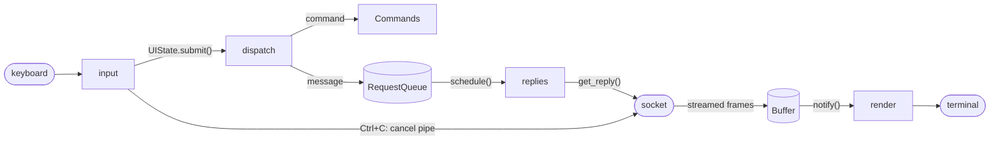

# Architecture

How `ttyllm` is put together: the threads, the request lifecycle, the raw HTTP
layer and the tool-calling loop. For installation and usage, see the
[README](README.md).

The guiding rule is **behaviour first**: the HTTP and stream parsing handles what
Ollama and OpenAI-compatible servers were observed to send, not everything the
specs allow. That keeps the wire layer small enough to read end to end. The
cost is spelled out under [What I'd fix next](#what-id-fix-next).

## Constraints

- **Standard library only.** No third-party packages at any layer.
- **Raw sockets.** HTTP is assembled and parsed by hand in `requester.py`.
- **POSIX terminals only.** `termios` raw mode, ANSI escapes, alternate screen.
- **Ollama and OpenAI-compatible backends.** No redirects, gzip, keep-alive or
  frame types that have not been seen.

## Where to start reading

1. `supervisor.py` starts the threads and wires everything together.
2. `buffer.py` is the shared state a chat lives in, with its locks and the
   cancellation pipe.
3. `requester.py` is the wire: request building, socket reads, stream parsing
   and the tool loop.
4. `view.py` and `box_drawing.py` turn a buffer into a screen.

## Component map

| Layer          | Module                  | Responsibility |
| -------------- | ----------------------- | -------------- |
| Entry          | `__main__.py`, `cli.py` | parse arguments, build `Supervisor`, run |
| Orchestration  | `supervisor.py`         | owns buffers, threads and the terminal |
| Scheduling     | `request_queue.py`      | serialises replies, one buffer at a time |
| Shared state   | `state.py`, `buffer.py` | `UIState` (view), `Buffer` (chat and synchronisation) |
| Wire           | `requester.py`          | raw-socket HTTP, streaming parsers, TLS |
| Terminal       | `terminal.py`           | raw input mode, alternate screen |
| Input          | `input_handler.py`      | keystrokes to actions, line editing |
| Presentation   | `view.py`, `box_drawing.py` | render state, lay out text boxes |
| Commands       | `commands.py`, `completion.py` | `:` commands, help, tab completion |
| Domain         | `models.py`, `tool.py`, `toolchain.py`, `api_key.py` | value objects and tools |

The repository root also holds a small `__main__.py`, which makes `python3 .` work
from a checkout without installing. `cli.py` imports the terminal-dependent
modules lazily, so `--help` and `--version` never touch the terminal layer.

## Threading model

`Supervisor.run_chat` starts four threads, each a wait-and-act loop guarded by a
condition variable, and joins them. Pressing `Ctrl+C` is read as an ordinary
key, because `ISIG` is disabled in raw mode, so the input thread handles it.

| Thread     | Loop                       | Waits on                | Woken by |
| ---------- | -------------------------- | ----------------------- | -------- |
| `input`    | `InputHandler.run`         | raw terminal reads      | keystrokes |
| `dispatch` | `Supervisor.watcher`       | `UIState.submitted`     | `UIState.submit()` |
| `replies`  | `Supervisor.queue_manager` | `RequestQueue` has work | `RequestQueue.schedule()` |
| `render`   | `Supervisor.update_buffer` | `Buffer.updated`        | `Buffer.notify()` |

- **dispatch** turns a submitted line into either a command
  (`Commands.execute`) or a new message (`handle_new_message`).
- **replies** pulls the next scheduled buffer and calls `Requester.get_reply`, so
  only one generation runs at a time.
- **render** redraws whenever the current buffer changes. After drawing, it only
  stores the new scroll position if `ui.scroll` is unchanged, so scrolling
  during a redraw is not overwritten.
- `Supervisor._guarded` wraps each target: a thread that raises shows a
  notification and restarts after a second, until `run` is cleared.
- The main thread installs a `SIGWINCH` handler that re-reads the terminal size
  and redraws.

### Locking rules

- Shared objects own their locks and **mutators take the lock themselves**. A
  caller must not hold a lock while doing slow work such as socket reads or
  drawing.
- `UIState` and `RequestQueue` each have one condition. A `Buffer` has two
  conditions, `cond` (the buffer changed) and `idle` (the request finished),
  sharing one re-entrant lock.
- `RequestQueue.schedule` takes the queue lock and then the buffer lock. Keep
  that order anywhere both are held.
- `Ctrl+R` and `Ctrl+E` (regenerate and undo) can wait up to
  `STOP_TIMEOUT` seconds for a running reply to stop. They are listed in
  `UNLOCKED_KEYS` and run without the UI lock, so the other threads can keep
  drawing and receiving while they wait.

## Request lifecycle

1. The user submits a line and `UIState.submit()` wakes the dispatch thread.
2. `handle_new_message` appends the normalised text to `chat_data["messages"]`.
3. `RequestQueue.schedule` queues the buffer, unless it is already queued or
   running.
4. The replies thread calls `Requester.get_reply` for the buffer.
5. `make_post` builds a raw HTTP/1.1 request and `_connect` opens the socket,
   wrapped in TLS for `https` endpoints.
6. `_get_header` reads the head, and `get_reply` hands the body to one reader
   per content type: `_stream_ndjson`, `_stream_sse` or `_read_json`. Each
   returns whether a tool call arrived.
7. Frames feed `_handle_msg`, which appends tokens to the buffer and updates token
   counts. Each `add_ai` notifies the render thread.
8. When the stream ends, `end_request` marks the buffer idle and wakes anything
   in `wait_idle`. On an error, a notification is shown instead.

## The raw HTTP layer

- **Request** (`make_post`): a hand-built request line (`POST /api/chat` for
  Ollama, `POST /v1/chat/completions` for OpenAI), `HOST`, `Content-Type`,
  `Content-Length`, and `Authorization: Bearer` when a key resolves.
- **Connect** (`_connect`): TCP with a connect timeout, wrapped in TLS through a
  cached `ssl` context. `-k` turns off verification for self-signed certificates.
- **Receive** (`_recv`): `select` with a read timeout, plus the buffer's
  cancellation pipe. A byte on the pipe aborts the read and returns `None`. For
  TLS it first drains `SSLSocket.pending()`, because `select` does not report
  bytes that are already decrypted.
- **Framing** (`_get_header`, `_get_all`, `_handle_json`): the head and body are
  split on `\r\n\r\n`. The body is read by `Content-Length` or decoded from
  chunked transfer encoding.
- **Errors** (`_friendly_error`): TLS, DNS, refused-connection and timeout
  failures become short, actionable messages, such as suggesting `http://` when
  the server does not speak TLS.

## Stream dialects

| Backend | Content type           | Reader           | Frames |
| ------- | ---------------------- | ---------------- | ------ |
| Ollama  | `application/x-ndjson` | `_stream_ndjson` | `message.content`, `done`, `prompt_eval_count` + `eval_count` |
| OpenAI  | `text/event-stream`    | `_stream_sse`    | `choices[0].delta.content`, `finish_reason`, `usage` |
| Either, with `stream` off | `application/json` | `_read_json` | one whole frame in the backend's format |

Edge cases handled, all taken from observed servers: the trailing usage-only chunk
with an empty `choices` array, `usage: null` on intermediate chunks, and only the
first choice being rendered. In the NDJSON path the HTTP chunk framing is
interleaved with the JSON lines, so the parser reads the hex chunk size inline.
When a server sends no usage figures, the token count is estimated.

## Tool-calling loop

Tool calls are opt-in. `-t` sets `Buffer.TOOLS`, which adds the tool schemas to
each request.

1. Streamed `tool_calls` fragments are reassembled by `index` in
   `_handle_tool_call`.
2. Complete calls are stored on the buffer (`set_pending`) and rendered for
   approval. Calls to unknown tools are settled immediately with an error result
   and are never executed.
3. `y` or `n` calls `Buffer.decide`. Once no call is undecided, the buffer is
   scheduled again.
4. `Requester.resume` runs the approved calls, appends `{"role": "tool", ...}`
   messages (declined calls get `user declined call`), and re-enters `get_reply`.
5. `MAX_TOOL_DEPTH = 8` bounds how many rounds one user message can trigger.

Editing keys are blocked while calls are pending. `Ctrl+C` declines every pending
call.

### Security model

The built-in `run_shell_command` tool runs through `subprocess` with `shell=True`
at the user's privilege level and is **not sandboxed**. The protection is the
approval step: every call is shown with its arguments and runs only after an
explicit `y`. Enable `-t` only with models and prompts you trust, preferably
inside a container.

## Cancellation and shutdown

`Buffer.cancel_request` sets a flag and writes a byte to the buffer's pipe. The
receive loop is blocked in `select` on both the socket and the pipe, so it
wakes immediately, sees the flag and unwinds. The pipe is drained at the start of
the next request so a stale cancel cannot stop it.

`Supervisor.handle_sigint` (bound to `Ctrl+C`) removes the buffer from the queue,
then either declines the pending tool calls or cancels the running request.
`stop()` clears `run` and notifies every condition so all threads exit. The
`raw_terminal` context manager restores the terminal on the way out.

## Rendering pipeline

`chat_data` is laid out by `box_drawing` (`text_to_lines`, `make_text_box`,
`fit_to_box`, `fit_text_to_box`) and drawn by `View.compose`, which switches on
`ViewMode`: `NORMAL`, `SYSTEM`, `DATA`, `HELP`, `MODELS`. A notification replaces
the box until the next keypress. `View` never mutates `UIState`. Drawing happens
on the render thread, and the command line is drawn separately from the box.

## Data model

A buffer holds `chat_data` in the **Ollama chat format**: `messages`, `model`,
`stream`, and sampling `options`. It is the single internal representation. For
OpenAI-compatible servers, `Buffer.openai_data` converts it on the way out.
`visual_data` (names and colours) is kept apart from the wire payload. Import and
export round-trip both as JSON.

## Design decisions

| Decision | Alternative | Why |
| -------- | ----------- | --- |
| One lock and condition per shared object | A single global lock | Rendering and socket reads must not block each other, and wake-ups can target one waiter. The cost is a lock order to respect (queue before buffer). |
| Cancellation pipe in `select` | Closing the socket from another thread, or short read timeouts | The reading thread wakes immediately and owns its own socket, so no thread closes a socket under another. |
| One reply at a time | A thread per buffer | Local models serve one generation at a time anyway, and the queue gives a clear order and a single cancel point. |
| Ollama format as the internal model | Store each backend's native format | One representation for rendering, import and export. The conversion lives in one place. |
| Per-call approval for tools | Allow-lists or auto-approve | The shell tool can do anything, and the user is the only reliable judge of a given command. |
| Hand-written HTTP | `urllib` or `http.client` | No dependencies was the rule, and writing it by hand keeps the whole wire exchange readable in one file. It is not a claim that this beats a library. |

## What I'd fix next

- **The stream readers parse chunk framing inline.** Each content type now has
  its own reader, but `_stream_ndjson` still finds chunk frames with
  `splitlines()` and a size heuristic, and `_stream_sse` assumes chunked
  encoding and that no SSE event spans two chunks. A shared chunked-body reader
  under both is the main refactor still open.
- **The status check matches `HTTP/1.1 200 OK`** instead of parsing the numeric
  code, so other success responses are reported as errors.
- **IPv4 only.** Sockets are created with `AF_INET`.
- **The shell tool returns stdout only.** The model does not see stderr or the
  exit code.
- **No HTTP features beyond observed need.** Redirects, `Content-Encoding` and
  keep-alive are not handled.

## Extension points

- **A command:** add an entry to the table in `commands.py`. Help text comes from
  the handler's docstring.
- **A tool:** write the function, wrap it in a `Tool` with its `Parameter`s, and
  append it to `toolchain` in `toolchain.py`.
- **A view mode:** add a `ViewMode` case and handle it in `View.compose`.

## Testing

The tests are plain `unittest`, use loopback sockets only and need no network.
How to run them is in the [README](README.md#development).

- `test_requester.py` runs real socket servers to exercise the parsers
  end to end, including chunked and streamed responses.
- `test_threading.py` covers the render, cancellation, queue, watcher and
  guarded-thread loops.
- `test_tool_approval.py` covers the approve, decline and unknown-tool paths.
